## Hi there 👋

This is [Misaka 0x4e21 (御坂0x4e21)](https://github.com/misaka4e21) ~~calling CQ and standing by~~

<!--
**misaka4e21/misaka4e21** is a ✨ _special_ ✨ repository because its `README.md` (this file) appears on your GitHub profile.

Here are some ideas to get you started:

- 🔭 I’m currently working on ...
- 🌱 I’m currently learning ...
- 👯 I’m looking to collaborate on ...
- 🤔 I’m looking for help with ...
- 💬 Ask me about ...
- 📫 How to reach me: ...
- 😄 Pronouns: ...
- ⚡ Fun fact: ...
-->

<a href="https://github.com/misaka4e21">
  <picture decoding="async" loading="lazy">
  <source media="(prefers-color-scheme: light)" srcset="./profile/stats.svg">
  <source media="(prefers-color-scheme: dark)" srcset="./profile/stats.svg">
  
</picture>
</a>

### Status
- Currently working on:
  - Package some software for [AOSC OS](https://github.com/AOSC-Dev)
  - [MyGO language](https://github.com/mygo-lang): Transpiler to Golang
  - [Commune](https://github.com/commune-project): ActivityPub-enabled forum server
- Formerly worked on:
  - [Discourse](https://github.com/discourse)
  - limonnur forum
